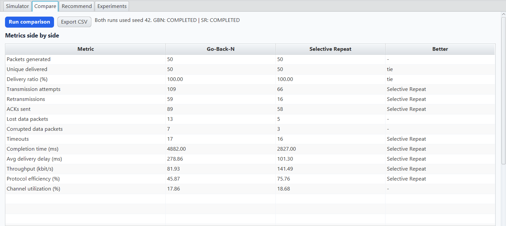
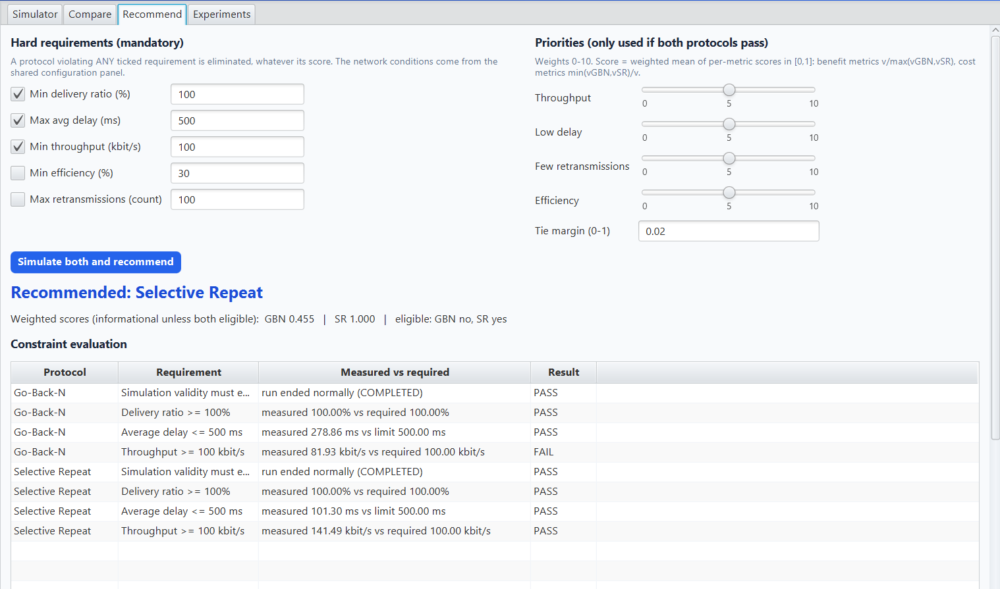
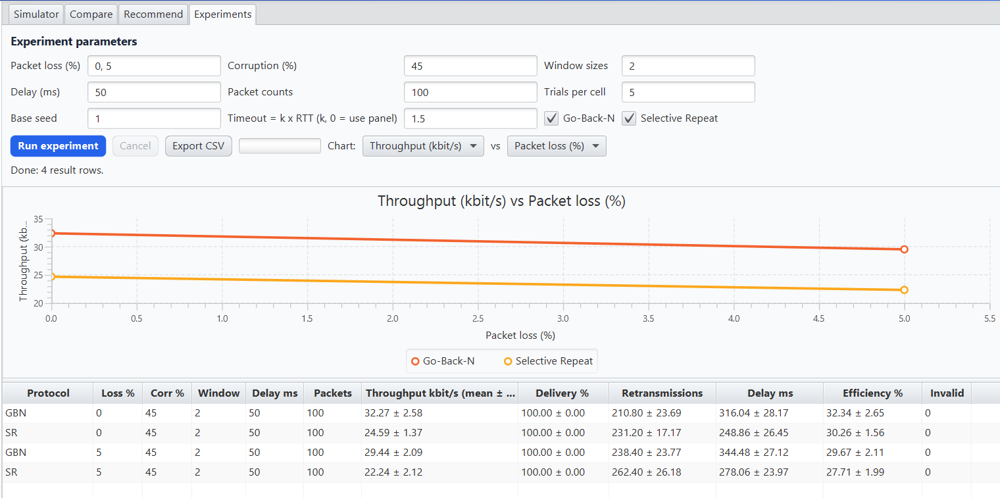
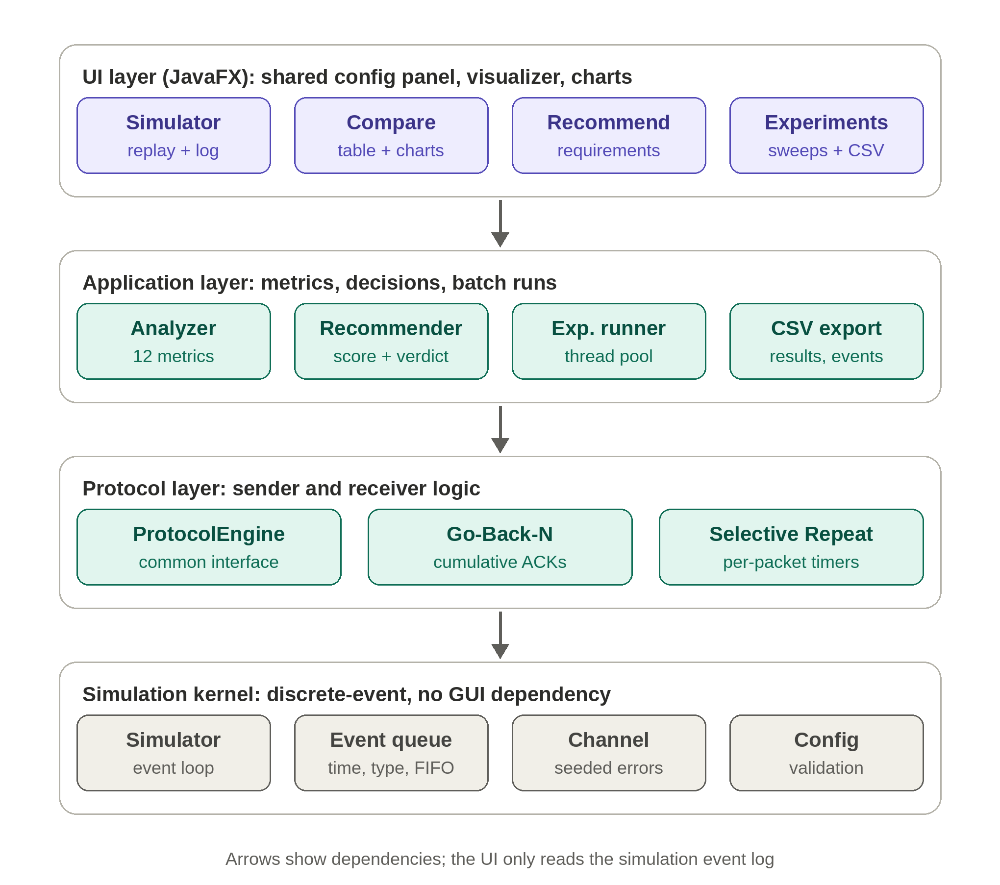

# Sliding Window Protocol Lab

    

**Interactive performance analysis and requirement-based selection of Go-Back-N and Selective Repeat sliding window protocols.**

Sliding Window Protocol Lab is a JavaFX desktop application built on a discrete-event network simulator. It lets you configure network conditions, watch both protocols handle loss, corruption, and delay, compare them under identical conditions, and get a **recommendation for the protocol that best meets your own requirements**, based on measured simulation results rather than textbook formulas alone.


## Table of contents
- [Motivation](#motivation)
- [Key features](#key-features)
- [Application tour and why each mode exists](#application-tour-and-why-each-mode-exists)
- [System architecture](#system-architecture)
- [Getting started](#getting-started)
- [Metrics](#metrics)
- [Recommendation engine](#recommendation-engine)
- [When to use which protocol](#when-to-use-which-protocol)
- [Real-life applications](#real-life-applications)
- [Project structure](#project-structure)
- [Testing](#testing)
- [Assumptions and limitations](#assumptions-and-limitations)
- [Future work](#future-work)
- [Author and license](#author-and-license)

## Motivation

Go-Back-N (GBN) and Selective Repeat (SR) are the two classic reliable sliding window protocols. Textbooks describe them and give formulas, but the better choice in practice depends on loss, corruption, delay, window size, and what the user actually needs (for example a minimum throughput or a maximum delay).

Most teaching simulators animate one protocol and show raw numbers. This project goes further:

- Both protocols run on the **same simulated network with the same seeded channel luck**, so differences come from the protocol design, not from random draws.
- Every result is computed from real simulation events and is never hardcoded.
- A **requirement-based recommendation engine** turns the metrics into a decision with an explanation.
- Edge cases that are often skipped are modeled: stale timers, sequence-number wraparound, corrupted ACKs, and abnormal termination.

## Key features

| Feature | Description |
|---|---|
| Discrete-event simulator | Simulated clock and priority queue, no `Thread.sleep`, reproducible with a seed |
| Go-Back-N | Cumulative ACKs, single timer, whole-window retransmission, out-of-order rejection |
| Selective Repeat | Per-packet timers, receiver buffering, individual ACKs, in-order delivery, sequence space 2W |
| Fault model | Packet loss, corruption, propagation and transmission delay, ACK delay, ACK errors |
| 12 metrics | Delivery ratio, retransmissions, delay, throughput, efficiency, utilization, and more |
| Packet visualization | Animated sender, channel, and receiver with Pause, Resume, Step, and Reset |
| Recommendation engine | Hard constraints, weighted preferences, tie and "neither" outcomes |
| Experiment mode | Parameter sweeps with repeated trials (mean and standard deviation), run in the background |
| CSV export | Results, event logs, and experiment tables |

## Application tour and why each mode exists

A shared configuration panel on the left (packets, window size, loss, corruption, delays, timeout, seed) feeds four modes. Each answers a different question.

### 1. Simulator: *"What actually happens to the packets?"*

**Why we built it:** protocol behavior is hard to understand from a diagram. The Simulator runs one protocol and replays the exact event log on screen: packets travel from sender to receiver, ACKs return, lost packets show a red mark, retransmissions are highlighted, and the window slides. Replay controls (Start, Pause, Resume, Step, Reset) let you inspect any moment. The event log and metric cards show precisely why the numbers came out as they did.

| Go-Back-N | Selective Repeat |
|---|---|
|  |  |

Running the same configuration in both protocols shows the core difference: after a loss, Go-Back-N rejects out-of-order packets and resends the whole window, while Selective Repeat buffers them and resends only the missing packet.

### 2. Comparison: *"Which protocol performs better under identical conditions?"*

**Why we built it:** a fair comparison needs identical conditions. This mode runs both protocols with the same configuration and the same seed, then shows the metrics side by side with charts for throughput, delivery ratio, retransmissions, delay, and efficiency, plus an explanation generated from the measured values. Nothing assumes that Selective Repeat always wins.

| Metric table | Charts |
|---|---|
|  |  |

### 3. Recommendation: *"Which protocol should I choose for my requirements?"*

**Why we built it:** this is the project's main contribution. Real users do not ask "which protocol has higher throughput?" but "which protocol meets my constraints?" You specify hard requirements (minimum delivery ratio, maximum delay, minimum throughput, minimum efficiency, maximum retransmissions) and optional priority weights. The engine simulates both protocols, eliminates any that violate a hard constraint, and explains the decision using the measured values. It can also report a tie or that neither protocol qualifies.



### 4. Experiments: *"How do the protocols behave across many conditions?"*

**Why we built it:** a single run can be misleading because loss is random. Experiment mode sweeps loss, corruption, window size, delay, and packet count, repeats each combination over several seeds, and reports the mean and standard deviation. It runs on a background thread, so the interface stays responsive, and the results can be charted and exported to CSV. This is where you find the crossover points where one protocol starts to outperform the other.



## System architecture



Four layers, each depending only on the one below:

1. **UI (JavaFX):** configuration panel, the four modes above, visualizer, and charts. It only reads results and never changes protocol behavior.
2. **Application:** metrics analyzer, recommendation engine, experiment runner, and CSV export.
3. **Protocol:** a common `ProtocolEngine` interface with `GoBackNEngine` and `SelectiveRepeatEngine`.
4. **Simulation kernel:** event loop, event queue, seeded channel, and configuration validation. It has no GUI dependency, so it can be tested on its own.

Key design decisions:

- **Event ordering:** events at the same timestamp are processed as data arrival, ACK arrival, transmit, then timer. An ACK arriving exactly at a timeout therefore cancels the timeout.
- **Fair channel:** the fate of each transmission is a hash of the seed, packet id, and attempt number, so both protocols face identical channel luck.
- **Safe termination:** a retry limit and an event limit prevent infinite runs. Runs that end abnormally are flagged invalid and never reported as results.

## Getting started

**Requirements:** JDK 21 and Maven 3.9+ (internet access is needed on the first build to download dependencies).

```bash
git clone https://github.com/sanjanak846/sliding-window-protocol-lab.git
cd sliding-window-protocol-lab
mvn clean javafx:run     # launch the GUI
mvn test                 # run the JUnit 5 tests
```

### IntelliJ IDEA
1. **File > Open**, select `pom.xml`, and choose **Open as Project**. Wait for the Maven import.
2. Set the Project SDK to JDK 21.
3. Run `com.netsim.ui.Launcher`. Use `Launcher` rather than `MainApp` to avoid the "JavaFX runtime components are missing" error.

### Quick usage
1. Set the network parameters in the left panel (probabilities in %, delays in ms).
2. Pick a mode: Simulator, Compare, Recommend, or Experiments.
3. Export results to CSV from any mode.

## Metrics

| Metric | Definition |
|---|---|
| Delivery ratio | unique packets delivered / packets generated x 100 |
| Retransmissions | transmission attempts beyond each packet's first |
| Average delay | mean of (in-order delivery time - first transmission time), including time spent waiting for retransmission |
| Throughput | delivered payload bits / total simulated time |
| Protocol efficiency | delivered payload bits / transmitted payload bits x 100 |
| Channel utilization | sender-link busy time / total time (reported separately from efficiency) |

If nothing is delivered, the average delay is shown as `n/a` and throughput and efficiency are 0. Full definitions are in [`docs/METRICS.md`](docs/METRICS.md).

## Recommendation engine

1. Validate the requirements.
2. Simulate both protocols with the same seed and conditions.
3. Check every hard constraint.
4. Eliminate any protocol that violates a hard constraint.
5. If one protocol survives, recommend it. If both survive, rank them by a weighted, normalized score; close scores give a tie.
6. If neither survives, report which constraints were violated.

A high score never overrides a violated hard constraint. Details are in [`docs/RECOMMENDATION.md`](docs/RECOMMENDATION.md).

**Example** (loss 20%, window 8, 100 packets, seed 42, other settings default): Go-Back-N needed 194 retransmissions and Selective Repeat needed 62. With "max retransmissions = 150", only Selective Repeat qualifies.

## When to use which protocol

| Conditions | Better choice |
|---|---|
| Clean link, small window | Equal results; Go-Back-N is simpler |
| Moderate or high loss, large window | Selective Repeat (far fewer retransmissions) |
| High delay (needs a large window) | Selective Repeat |
| Simple, memory-limited receiver | Go-Back-N |

Always confirm with the Experiments mode, since results depend on the timeout and your requirements.

## Real-life applications

This tool models the trade-offs behind real protocol design. It is a simulation, not a measurement of a real network, but it is useful for:

- **Education and teaching labs:** students can see and measure protocol behavior instead of memorizing formulas.
- **Protocol selection for link design:** estimating whether a simple or a more complex retransmission scheme is worth it for a given link, such as satellite or other high-latency links, wireless and lossy links, or low-bandwidth links.
- **Embedded and IoT systems:** deciding whether a memory-limited device can use the simpler Go-Back-N approach or needs receiver buffering for efficiency.
- **Capacity and efficiency planning:** estimating how much bandwidth is wasted on retransmissions at a given error rate and window size.
- **Requirement-driven design reviews:** checking quickly whether a design can meet stated throughput, delay, or efficiency targets before building it.
- **Research and benchmarking:** a reproducible baseline for studying retransmission schemes, with fixed seeds and CSV export.

These ideas also appear in real protocols. For example, selective acknowledgment in TCP follows the same principle as Selective Repeat, and cumulative acknowledgment with retransmission of a window appears in simpler link-layer schemes.

## Project structure

```
src/main/java/com/netsim/
  sim/          simulation kernel (config, events, channel, simulator)
  protocol/     ProtocolEngine, GoBackNEngine, SelectiveRepeatEngine
  analysis/     metrics, requirements, recommendation engine
  experiment/   experiment runner, CSV export
  ui/           JavaFX application
src/test/java/  JUnit 5 tests
docs/           METRICS.md, RECOMMENDATION.md, images/
samples/        sample experiment scenarios
```

## Testing

`mvn test` runs 59 JUnit 5 tests covering: single and multiple packets, lost data, lost ACKs, high loss, high delay, window sizes, corruption, stale timers, simultaneous events, window advancement, sequence wraparound (a randomized 400-run check that every packet is delivered once and in order), termination, reproducibility, metric formulas, and the recommendation outcomes (one, both, or neither protocol qualifies). Expected timings are derived by hand from the model rather than copied from observed output.

## Assumptions and limitations

- Corrupted packets and ACKs arrive and are discarded by the receiver.
- Timers start when a packet's last bit leaves the sender; stale timers are ignored.
- Single flow, fixed timeout (no RTT estimation), no header overhead, fixed packet size.
- Results describe the simulated model, not a real network.

## Future work

- Adaptive timeout based on RTT estimation
- TCP-style variants such as fast retransmit and selective acknowledgment
- Runtime protocol switching based on measured conditions
- Multiple concurrent flows and bandwidth sharing

## Author 

**Sanjana K** ([@sanjanak846](https://github.com/sanjanak846)): Computer Networks academic project.


